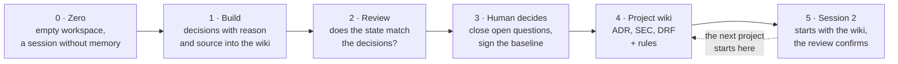

# Boss Your Agents: How AI Secures What AI Teams Build

Material for my talk at the Ticino Data Conference 2026 in Bioggio (30 October 2026): the five steps of the demo as files and commands you can read and rerun, the slides, five recordings of one real run, and the project wiki a run of the same engine produced.

## The talk in one paragraph

Agents that build on Microsoft Fabric make dozens of decisions: how to load the data, which storage mode, how to secure the model, what to call things. Most of those decisions vanish with the session. The talk follows one project from zero to hero. Session 1 builds with a single extra instruction: record every decision, with the reason and a Microsoft Learn source, in a wiki. Three reviewers with their own identity and a fresh context compare the deployed state with that log and with a visible security baseline, and they ask about what nobody decided instead of hunting for mistakes. A human closes the open questions in one sentence each and signs the baseline. A Claude session compiles log, review and decisions into a project wiki with machine-checkable rules. Session 2 starts with that wiki, plans with its ids, builds, and the same review confirms. Agents make good decisions when you let them record, check and hand them on. You decide what becomes a rule.



## Where to start

| You want | Go to |
|---|---|
| the slides | [slides/boss-your-agents-ticino-2026.pdf](slides/boss-your-agents-ticino-2026.pdf) |
| to see it run | [recordings/](recordings/): five short videos of one real run |
| what a project wiki looks like | [example-run/](example-run/): the wiki, gate reports and plan of a separate run of the same engine |
| to rebuild it in your own tenant | [template/](template/) and the steps below |

## The five steps

Every step is one file, one command or one prompt. The folder names are the ones `template/stage.sh` creates.

### 0 · Zero: what a session needs before it builds anything

What it teaches: a decision log needs an instruction and a place to write. The builder session starts empty: its own Claude Code profile, its own Fabric identity, two tools. Microsoft Learn for knowledge, a wiki for memory.

| File | What it holds |
|---|---|
| [`session-1/CLAUDE.md`](template/session-1/CLAUDE.md) | the tools and the decision log instruction: what, why, alternatives, Microsoft Learn URL, recorded when the decision is made |
| `session-1/.mcp.json` (written by `stage.sh`) | `microsoft-learn` (`https://learn.microsoft.com/api/mcp`) and `wiki` (see «The wiki server» below) |
| [`session-1/.claude/settings.json`](template/session-1/.claude/settings.json) | the deny rules: the builder cannot read the reviewers' scripts, their agent definitions, session 2 or its own `.claude/` folder, and edits only `work/` and `rules/` |
| [`session-1/task/sales-request.md`](template/session-1/task/sales-request.md) | the business request, with no names and no rules |

```bash
cd /tmp/boss-your-agents/session-1
cat CLAUDE.md
cat .mcp.json
./run.sh
```

### 1 · Build with a decision log

What it teaches: what a good decision page looks like. Session 1 creates a lakehouse, loads two CSV files as Delta tables, writes a Direct Lake model in TMDL with row-level security and adds the role members. Every choice becomes one wiki page.

```text
/build
```

[`/build`](template/session-1/.claude/commands/build.md) is one line: «Read `task/sales-request.md` and deliver it.» The result is a set of pages in `session-1/.omc/wiki/`; see the decision pages in [example-run/wiki/](example-run/wiki/).

### 2 · Review: does the state match the decisions, and what was never decided?

What it teaches: separate the reviewers, give them their own identity and a fresh context, require evidence, ask for gaps rather than for mistakes.

```bash
cd /tmp/boss-your-agents/review && ./run.sh
/review
cat reports/latest-gate.md
```

| Reviewer | Checks | Findings |
|---|---|---|
| [`security-reviewer`](template/review/.claude/agents/security-reviewer.md) | the security baseline written in its own definition: a column with a sensitive name sits under an RLS role with members | `SEC-001`, `SEC-003`, `SEC-004` blocking; `SEC-010` workspace roles not readable (info for a human) |
| [`decision-reviewer`](template/review/.claude/agents/decision-reviewer.md) | every fact of the deployed state (F1, F2, ...) against the decision log: covered, contradicts or open | `DEC-1nn` blocking when the state contradicts a recorded decision; `Q-n` an open question, never blocking |
| [`drift-reviewer`](template/review/.claude/agents/drift-reviewer.md) | the deployed definitions against the last signed snapshot | `DRF-000` no baseline yet (info); `DRF-001` to `DRF-006` blocking |

[`/review`](template/review/.claude/commands/review.md) runs the three in parallel and then the gate. The gate is BLOCKED when any reviewer reports a blocking finding or is missing, PASSED otherwise. In the recorded run, the gate passed with one open question: «What naming convention should items follow (sales_lh, Sales), and why these names?» Session 1 never decided naming; the reviewer asked instead of failing it.

### 3 · Human decides

What it teaches: agents propose and record, you decide what becomes a rule.

```text
cd /tmp/boss-your-agents/session-1 && ./run.sh
/decide Items use type prefixes: lh_, sm_, rpt_, nb_, lower case, underscores, so anyone can tell an item's type from its name
```

```bash
cd /tmp/boss-your-agents/review && ./py gate/snapshot.py sign
```

[`/decide`](template/session-1/.claude/commands/decide.md) records the sentence verbatim as a decision page tagged `decided-by-human`, with the open question it closes and the items that do not follow it yet. It never invents a reason. `snapshot.py sign` signs only when the latest gate report says PASSED and the deployed state is still the reviewed one (ssh-keygen ed25519 key outside the project, so an agent that edits the snapshot breaks the signature).

### 4 · Project wiki

What it teaches: what belongs in the wiki and how a rule becomes checkable.

```text
/compile-wiki
```

```bash
cd /tmp/boss-your-agents && ./publish-wiki.sh
```

[`/compile-wiki`](template/session-1/.claude/commands/compile-wiki.md) is a Claude session, not a script. From the decision log, the review and the human decision it writes one ADR per accepted decision, one SEC page per security finding, one DRF page with the signed baseline, and one rule file per ADR that a check can express. Only the sections and the rule schema are given; every sentence comes from the run. [`publish-wiki.sh`](template/publish-wiki.sh) copies the wiki into a visible folder and lints the rules.

The rule schema (read by [`gate/check_rules.py`](template/gate/check_rules.py)):

```yaml
id: ADR-005
title: Item naming with type prefixes
status: accepted
decided_by: <the session, or the human>
decision: <one paragraph>
page: <file of the ADR page>
sources: [<Microsoft Learn URL>]
check:                       # one or more of these kinds
  item_names: {<Fabric item type>: <regex for the whole name>}
  storage_mode: direct_lake_onelake | direct_lake_sql | import
  rls: {table_with_columns: [<column>], filter_contains: <text in the filter>, min_members: <n>}
  lakehouse_schemas: true | false
```

### 5 · Session 2 starts with knowledge

What it teaches: hand the knowledge on, and keep the review.

```bash
cd /tmp/boss-your-agents && ./handover.sh
cd session-2 && ./run.sh
/governed-build
approve
```

[`handover.sh`](template/handover.sh) copies `wiki/` into session 2 and adds one line to its `CLAUDE.md`:

```text
Project wiki of the last delivery: @wiki/index.md - read it and the pages it lists before you plan, and cite their ids.
```

[`/governed-build`](template/session-2/.claude/commands/governed-build.md): the [builder](template/session-2/.claude/agents/builder.md) writes `work/PLAN.md` citing the ADR ids and builds; [`security-reviewer`](template/session-2/.claude/agents/security-reviewer.md), [`rules-reviewer`](template/session-2/.claude/agents/rules-reviewer.md) (the wiki's rules) and [`drift-reviewer`](template/session-2/.claude/agents/drift-reviewer.md) check; at most two remediation rounds; signing asks the human (an `ask` permission rule). In the recorded run the plan cited ADR-001 to ADR-005, SEC-010 and DRF-000, session 2 built `lh_sales` and `sm_sales`, and the gate passed in round 1.

## Do it on Monday

- [ ] Give each agent its own identity in the workspace, never yours and never an admin.
- [ ] Put Microsoft Learn MCP and a wiki into `.mcp.json`.
- [ ] Add one paragraph to `CLAUDE.md`: record every decision as its own page, with what, why, the alternatives and the Microsoft Learn URL, when you make it.
- [ ] Deny the builder access to the reviewers' definitions and scripts in `.claude/settings.json`.
- [ ] Review with separate agents, their own identity and a fresh context, against the decision log and a security baseline that is written down where everyone can read it.
- [ ] Treat a missing decision as an open question for a person, not as a failure.
- [ ] Close each open question in one sentence, then sign the baseline.
- [ ] Compile the wiki (ADR, SEC, DRF, rules) and start the next session with `@wiki/index.md`.

## The template

[`template/`](template/) holds everything the demo ran, with the tenant taken out. It works with any two empty Fabric workspaces and identities you provide.

```bash
cd template
cp config.example.env config.env      # workspaces, identities, token commands; never commit config.env
python3 data/make_data.py             # with ACCOUNT_MANAGERS=... to put a real user of your tenant first
./stage.sh /tmp/boss-your-agents
```

Prerequisites: Claude Code, Python 3 with `pyarrow` and `pyyaml`, Node.js (wiki server), `ssh-keygen`, the Azure CLI (or any other way to print an access token), a Fabric capacity with two empty workspaces, and three identities of your tenant:

| Identity | Workspace role | Why |
|---|---|---|
| builder | Contributor in both workspaces | builds; cannot share items or change workspace roles |
| reviewer | Contributor in both workspaces | reads definitions; `getDefinition` requires write permission, see «Not covered» |
| viewer | none | the account manager in the RLS role; put its UPN in `data/customers.csv` |

| Path | What it is |
|---|---|
| `stage.sh`, `config.example.env`, `run.sh`, `py` | staging into `/tmp/...` (refuses a target below a folder with a `CLAUDE.md`), `.lab-env` per folder, Claude Code start (optional clean profile with `PROFILE=<dir>`) |
| `session-1/` | steps 0, 1, 3, 4: `CLAUDE.md`, `/build`, `/decide`, `/compile-wiki`, deny rules, the request |
| `review/` | step 2: `CLAUDE.md`, `/review`, three reviewer agents, settings with the role guard hook |
| `session-2/` | step 5: the governed section of `CLAUDE.md`, `/governed-build`, builder and three reviewers, signing asks |
| `publish-wiki.sh`, `handover.sh` | steps 4 and 5 |
| `toolkit/` | the builder's Fabric tool `fab.py` (lakehouse create, upload, load table over OneLake without Spark, TMDL lint and deploy, DAX query, RLS members) and its helpers |
| `gate/` | the reviewers' scripts, the gate, the signed snapshot and the role guard (`./py gate/role_guard.py --self-test`, offline) |
| `data/` | the request's CSV files and the deterministic generator |

Each folder's `.lab-env` names the workspace and only the identities its agents may use: the builder folder cannot get a reviewer token, the review folder cannot get a builder token. A token command prints an access token for `$RESOURCE`; the example in `config.example.env` keeps one Azure CLI login per identity with `AZURE_CONFIG_DIR`. Never put a password into it: agents can read `.lab-env`.

All slash commands carry `disable-model-invocation: true`: only a person starts a step.

### The wiki server

The demo used only the MCP server of oh-my-claudecode (`bridge/mcp-server.cjs` from the npm package [`oh-my-claude-sisyphus`](https://www.npmjs.com/package/oh-my-claude-sisyphus), release 5.7.18), not the plugin. With `OMC_DISABLE_TOOLS` it serves just the wiki tools (`wiki_add`, `wiki_ingest`, `wiki_query`, `wiki_list`, `wiki_read`, ...), which write Markdown pages with front matter and keep `index.md` and `log.md`. Outside a git repository it writes to a wiki in your home folder, so `stage.sh` makes each session folder a git repository and sets `OMC_DISABLE_MULTIREPO=1` and an empty `OMC_STATE_DIR`.

A plain Markdown alternative works too: drop the `wiki` server, and change the decision log paragraph in `CLAUDE.md` and the three commands to «write one Markdown file per decision into `wiki/`» with the Write tool, plus «keep `wiki/index.md` with one line per page». The reviewers only read Markdown files (`DECISIONS` in `.lab-env`), and the rules are YAML either way. What you lose is the automatic index and log.

## Not covered, honestly

- **The reviewer is not read-only.** It is Contributor because Fabric's `getDefinition` requires write permission on the item, and the scripts write a helper notebook and its result file to read the RLS members. That the reviewers change nothing else is enforced by the session (permissions, role guard hook), not by the platform.
- **The security baseline is coarse on purpose.** It checks that a role filters the table with sensitive columns and has members, not what the filter does: a filter `TRUE()` passes. A column counts as sensitive only by its name or source column. Relationships are assumed active and single-direction.
- **RLS role members are not in the model definition** and have no REST API. The toolkit sets and reads them through a pure Python notebook inside Fabric (sempy and TOM over XMLA), about 45 seconds per call.
- **One F2 capacity.** All numbers come from an F2. The Load Table API keeps a Spark session open there for 20+ minutes and blocks further loads (HTTP 430), so the toolkit writes Delta tables directly over OneLake with pyarrow.
- **Members must exist in the tenant.** Addresses outside the tenant are refused; the sessions record that as an open point.
- **Viewer access with Direct Lake on OneLake** needs a fixed-identity connection, which the builder identity cannot set. The sessions record that and leave it to a workspace admin.
- **The gate checks governance, not function.** A model that does not load can pass.
- **The open question is real, not guaranteed.** In every rehearsal, session 1 did not record a naming decision and the decision reviewer asked exactly that. A model makes that judgment; another run can bring a different question, or none.
- **Tested offline in this repository, not end to end.** The template's toolkit replaces the lab's sign-in with token commands. The scripts, the role guard self-test, the rule lint and the reviewers' checks against a recorded state run offline; a full run in your tenant is the real test.

## Author

Matthias Falland, Microsoft Data Platform MVP. LinkedIn: [linkedin.com/in/matthias-falland](https://www.linkedin.com/in/matthias-falland/)

Questions and your own experiences with agents in Fabric are welcome on LinkedIn.

## License

Code (`template/`) is licensed under the [MIT License](LICENSE). Everything else (README, example run, recordings, slides) is licensed under [CC BY 4.0](LICENSE-CONTENT.md), except the conference template and sponsor logos in the slide PDF, which belong to their owners. Microsoft, Fabric and related names are trademarks of Microsoft; linked Microsoft Learn pages are Microsoft's content.
