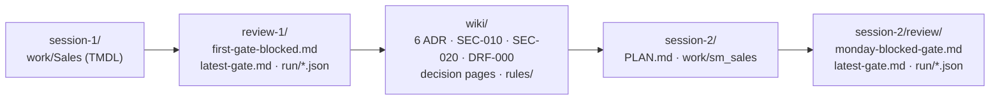

# Example run

These files come from the recorded run of 28 October 2026 (Claude Code, headless, one F2 capacity), the
same run that the [recordings](../recordings/) show: session 1 named its items `sales_lh` and `Sales`,
session 2 built `lh_sales` and `sm_sales`. Nothing was written by hand and no text was edited.

The files are scrubbed for publication:

| Replaced | By |
|---|---|
| the sign-in names and short names of the three demo identities | `builder@contoso.example`, `reviewer@contoso.example`, `viewer@contoso.example` |
| workspace, lakehouse and semantic model ids, also inside OneLake URLs | `<workspace-1-id>`, `<lakehouse-1-id>`, `<model-1-id>` (session 1), `<workspace-2-id>`, `<lakehouse-2-id>`, `<model-2-id>` (session 2); other ids `<id-n-id>` |
| the host names of the two SQL analytics endpoints | `<sql-endpoint-1-host>`, `<sql-endpoint-2-host>`, shortened in the reports to `<sql-endpoint-host>...` |
| the SSH signatures of the signed baselines | removed (`baseline.json` says so) |

The workspace names («FF Ticino Session 1 DEV», «FF Ticino Session 2 DEV») and the two fictitious account
managers at `example.com` stayed as they were. The hashes in `baseline.json` and `drift.json` are those of
the original definitions; the scrubbed TMDL files no longer match them. Session 2's `CLAUDE.md` and its own
decision log were not saved in this run; [../template/session-2/](../template/session-2/) shows what
`handover.sh` puts there.

## What happened

| Step | Result | Files |
|---|---|---|
| 1 · Build | Session 1 built the lakehouse `sales_lh` and the Direct Lake model `Sales` with a dynamic RLS role; only the tenant user became a role member, the two `example.com` account managers stayed pending. A page per decision. | [`session-1/work/Sales/`](session-1/work/Sales/), the decision pages in [`wiki/`](wiki/) |
| 2 · Review | BLOCKED at 07:19, 1 blocking: SEC-020, a role member reads 60 of 60 rows of `customers` through the SQL analytics endpoint, where the model's RLS does not apply. One open question, Q-1 on how items are named. | [`review-1/first-gate-blocked.md`](review-1/first-gate-blocked.md) |
| 3 · Human decides | Two `/decide` sentences: the account-manager rule applies in the model and in the SQL endpoint (answers SEC-020), and items use type prefixes (answers Q-1). The rule was added in the SQL endpoint; the review at 07:35 PASSED, the probe read 20 of 60 rows, none of another user. Then the baseline signed. | [`review-1/latest-gate.md`](review-1/latest-gate.md), [`review-1/run/`](review-1/run/), [`review-1/baseline.json`](review-1/baseline.json) |
| 4 · Project wiki | `/compile-wiki`: ADR-001 to ADR-006 (ADR-005 naming and ADR-006 the rule in every engine are the decisions of a person), SEC-010, SEC-020, DRF-000 and five rules. | [`wiki/`](wiki/), [`wiki/rules/`](wiki/rules/) |
| 5 · Session 2 | The plan cites ADR-001 to ADR-006, SEC-010, SEC-020 and DRF-000; session 2 built `lh_sales` and `sm_sales` with the rule in the model and in the SQL endpoint. Gate PASSED at 07:51. | [`session-2/PLAN.md`](session-2/PLAN.md), [`session-2/work/sm_sales/`](session-2/work/sm_sales/) |
| 6 · Monday morning | The model renamed by hand to «Sales Model»: BLOCKED at 07:58 with DEC-201 (breaks ADR-005) and DRF-003 (drift from the signed snapshot). Renamed back: PASSED at 08:00. | [`session-2/review/monday-blocked-gate.md`](session-2/review/monday-blocked-gate.md), [`session-2/review/latest-gate.md`](session-2/review/latest-gate.md), [`session-2/review/run/`](session-2/review/run/) |

The wiki pages are the output of the wiki server: front matter, a heading per page, `index.md` and `log.md`
maintained by the server (its index lines use a dash of its own). The texts are verbatim.
