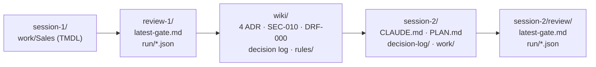

# Example run

These files come from a real run of the demo on 27 October 2026 (Claude Code, headless, one F2 capacity).
**It is a separate run of the same engine, not the run in the [recordings](../recordings/).** Agents decide
for themselves, so the two runs differ: in the recordings session 1 named its items `sales_lh` and `Sales`
and the review asked one question; here session 1 named them `SalesLakehouse` and `Sales` and the review
asked three. Nothing was written by hand and no text was edited.

The files are scrubbed for publication:

| Replaced | By |
|---|---|
| the sign-in names and short names of the three demo identities | `builder@contoso.example`, `reviewer@contoso.example`, `viewer@contoso.example` |
| workspace, lakehouse and semantic model ids, also inside OneLake URLs | `<workspace-1-id>`, `<lakehouse-1-id>`, `<model-1-id>` (session 1), `<workspace-2-id>`, `<lakehouse-2-id>`, `<model-2-id>` (session 2) |
| the SSH signatures of the signed baselines | removed (`baseline.json` says so) |

The workspace names («FF Ticino Session 1 DEV», «FF Ticino Session 2 DEV») and the two fictitious account
managers at `example.com` stayed as they were. The hashes in `baseline.json` and `drift.json` are those of
the original definitions; the scrubbed TMDL files no longer match them.

## What happened

| Step | Result | Files |
|---|---|---|
| 1 · Build | Session 1 built the lakehouse `SalesLakehouse` and the Direct Lake model `Sales` with a dynamic RLS role and one member. Four decision pages: loading over OneLake without schemas, Direct Lake on OneLake, dynamic RLS per account manager, role members only from the tenant. No page decided naming or the model's shape. | [`session-1/work/Sales/`](session-1/work/Sales/), the `decision-*` pages in [`wiki/`](wiki/) |
| 2 · Review | PASSED, 0 blocking, 4 of 7 facts covered by the log, three open questions: Q-1 naming («Why are the items named SalesLakehouse and Sales, and is that the naming convention you want?»), Q-2 the tables and columns, Q-3 the measures. SEC-010 and DRF-000 as notes for a person. | [`review-1/latest-gate.md`](review-1/latest-gate.md), [`review-1/run/`](review-1/run/) (facts, the decision reviewer's verdicts, security, drift, the state it read) |
| 3 · Human decides | `/decide Items use type prefixes: lh_, sm_, rpt_, nb_, lower case, underscores, so anyone can tell an item's type from its name` answers Q-1; Q-2 and Q-3 stay open. Then the baseline signed. | [`wiki/decision-item-naming-...md`](wiki/decision-item-naming-convention-with-type-prefixes-lh-sm-rpt-nb.md), [`review-1/baseline.json`](review-1/baseline.json) |
| 4 · Project wiki | `/compile-wiki`: ADR-001 to ADR-004 (ADR-004 is the naming decision of a person), SEC-010, DRF-000 and four rules (`lakehouse_schemas`, `storage_mode`, `rls`, `item_names`). | [`wiki/`](wiki/), [`wiki/rules/`](wiki/rules/) |
| 5 · Session 2 | `CLAUDE.md` ends with the handover line. The plan cites ADR-001 to ADR-004, SEC-010 and DRF-000; session 2 built `lh_sales` and `sm_sales`. Gate PASSED in round 1, 0 blocking. | [`session-2/CLAUDE.md`](session-2/CLAUDE.md), [`session-2/PLAN.md`](session-2/PLAN.md), [`session-2/decision-log/`](session-2/decision-log/), [`session-2/review/latest-gate.md`](session-2/review/latest-gate.md) |

The two questions nobody answered (Q-2, Q-3) did not become rules: the wiki holds only what was decided.

The wiki pages are the output of the wiki server: front matter, a heading per page, `index.md` and `log.md`
maintained by the server (its index lines use a dash of its own). The texts are verbatim.
